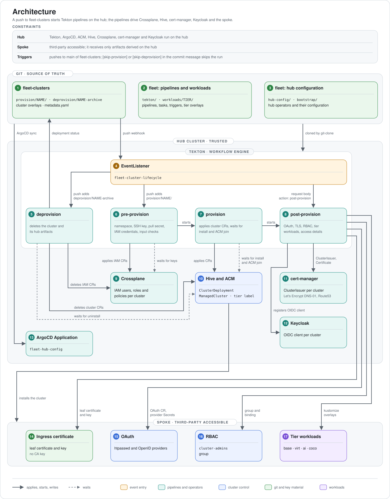

# fleet

[](https://github.com/redhat-openshift-partner-labs/fleet/actions/workflows/ci.yml)
[](https://github.com/redhat-openshift-partner-labs/fleet/actions/workflows/build-image.yml)
[](https://github.com/redhat-openshift-partner-labs/fleet/releases/latest)


fleet is the control plane for the Red Hat OpenShift Partner Labs cluster fleet. It is for the lab operators who provision, configure and deprovision the OpenShift clusters delivered to partners.

**Status:** Early development. Architecture agreed; implementation in progress.

## Architecture



Diagram source: [docs/diagrams/architecture.mermaid](docs/diagrams/architecture.mermaid). Components, trust boundary and pipelines: [docs/architecture.md](docs/architecture.md).

| Component | Role |
|---|---|
| Git | Source of truth: pipelines and hub configuration in this repo, cluster definitions in fleet-clusters |
| Tekton (OpenShift Pipelines) | Workflow engine for pre-provision, provision, post-provision, and deprovision |
| ArgoCD (OpenShift GitOps) | Manifest delivery to the hub |
| ACM + Hive | Fleet membership and cluster provisioning |
| cert-manager | Hub-side TLS certificate management; spokes receive only derived artifacts |
| Crossplane | Per-cluster IAM user generation; installed by `hub-config/crossplane/` |

## What this repository holds

- The Tekton pipelines, tasks and triggers that run the cluster lifecycle
- The Python CLI tools that implement the Tekton tasks, built into one pipeline image
- The hub cluster configuration (operators, Crossplane, ArgoCD bootstrap)
- The tier workload overlays that the post-provision pipeline applies to a spoke

It does not hold cluster definitions or tenant application manifests. Cluster definitions live in [fleet-clusters](https://github.com/redhat-openshift-partner-labs/fleet-clusters); a push to that repository triggers the pipelines defined here.

## Pipelines

| Pipeline | Purpose | Tasks |
|---|---|---|
| [`pre-provision`](tekton/pipelines/pre-provision.yaml) | Creates the cluster namespace, SSH key, pull secret and IAM credentials, validates the cluster inputs, and starts `provision` | 14 |
| [`provision`](tekton/pipelines/provision.yaml) | Applies the cluster resources, waits for Hive and the ManagedCluster, reads the tier, and starts `post-provision` | 11 |
| [`post-provision`](tekton/pipelines/post-provision.yaml) | Configures OAuth, the TLS certificate and RBAC on the spoke, applies the tier workloads, and publishes the access details | 23 |
| [`deprovision`](tekton/pipelines/deprovision.yaml) | Terminates the pod VMs of a `coco` cluster, deletes the cluster, waits for the Hive uninstall, removes hub artifacts, and records the result | 7 |
| [`test-vcluster`](tekton/pipelines/test-vcluster.yaml) | Runs `post-provision` against a temporary vCluster on the hub | 5 |

## Tiers

The `tier` label on a ManagedCluster selects what the post-provision pipeline installs. Every tier includes `base`.

| Tier | Overlay | Installs |
|---|---|---|
| `base` | [`workloads/base/`](workloads/base) | Core configuration: OAuth, TLS certificate, RBAC, and the base overlay |
| `virt` | [`workloads/virt/`](workloads/virt) | OpenShift Virtualization; Node Feature Discovery when the catalog provides it |
| `ai` | [`workloads/ai/`](workloads/ai) | OpenShift AI 2.x or 3.x, for CPU or GPU |
| `coco` | [`workloads/coco/`](workloads/coco) | OpenShift sandboxed containers with peer pods on AWS |

## Repository layout

```
.
├── bootstrap/          # Hub bootstrap (ArgoCD Application for hub-config)
├── hub-config/         # Hub operators: ACM, GitOps, Pipelines, cert-manager, RH-SSO, Crossplane
├── tekton/             # Pipeline, Task, EventListener, Trigger definitions
├── workloads/          # Tier-specific day-2 overlays (base / virt / ai / coco)
├── fleet/              # Python CLI tools for Tekton pipeline tasks
├── tests/              # Unit and validation tests
└── docs/               # Architecture, runbooks, diagrams
```

## Documentation

| Guide | Covers |
|---|---|
| [User guide](docs/user-guide.md) | Provisioning, managing and deprovisioning clusters; troubleshooting |
| [Developer guide](docs/developer-guide.md) | Local setup, checks, adding a Tekton task, the pipeline image |
| [Architecture](docs/architecture.md) | Components, trust boundary, trigger chain, pipelines, AWS credential modes |
| [Hub cluster setup](hub-config/README.md) | Installing, verifying and uninstalling the hub operators |
| [fleet-clusters setup](docs/fleet-clusters-setup.md) | Repository structure, GitHub App, webhook and archive workflow |
| [Image pull secret setup](docs/image-pull-secret-setup.md) | Credentials for pulling the pipeline image from quay.io |
| [Per-cluster metadata](docs/per-cluster-metadata.md) | The `metadata.yaml` keys and how their values reach the tasks |
| [Parameter threading](docs/parameter-threading.md) | How a parameter passes from a trigger to a task |
| [Confidential containers tier](docs/coco-tier.md) | Prerequisites, limits and operation of `coco` clusters |
| [OpenShift AI operator mapping](docs/openshift-ai-operator-and-component-mapping.md) | Operators and components for OpenShift AI 2.x and 3.x |
| [vCluster test infrastructure](docs/vcluster.md) | Testing `post-provision` against a temporary vCluster |

## Development

Prerequisites: Python 3.11 or later and [Poetry](https://python-poetry.org/). The [developer guide](docs/developer-guide.md) lists the remaining tools.

```bash
poetry install
tox
```

`tox` runs the unit tests, which require 100% line coverage of `fleet/`, and the linters. CI does not run `tox -e validate-kustomize`; run it locally.

## Status

| Area | State |
|---|---|
| Architecture direction | Agreed |
| Repo structure | Done |
| Hub bootstrap (Tekton, cert-manager, Crossplane) | Done (manifests ready, not yet applied) |
| Development tooling (yamllint, tox, pytest) | Done |
| CI (GitHub Actions: gitleaks, tox, tekton-lint) | Done |
| Container image build (multi-arch, quay.io/rhopl) | Done |
| Pre-provision and provision pipelines | Done |
| Post-provision pipeline (base, virt, ai, coco tiers) | Done |
| Deprovision pipeline | Done |
| Tekton triggers (pre-provision, post-provision, deprovision) | Done |

## Background

This repo supersedes the cluster-lifecycle portions of [`labargocd`](https://github.com/redhat-openshift-partner-labs/labargocd).

## Contributing

This repository does not accept external pull requests. Report bugs and request features through [GitHub issues](https://github.com/redhat-openshift-partner-labs/fleet/issues).
