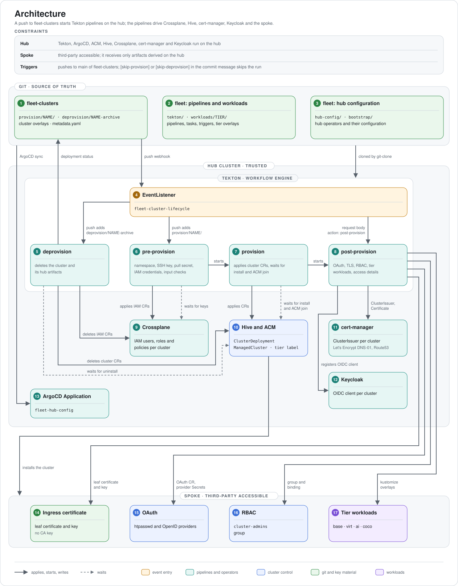
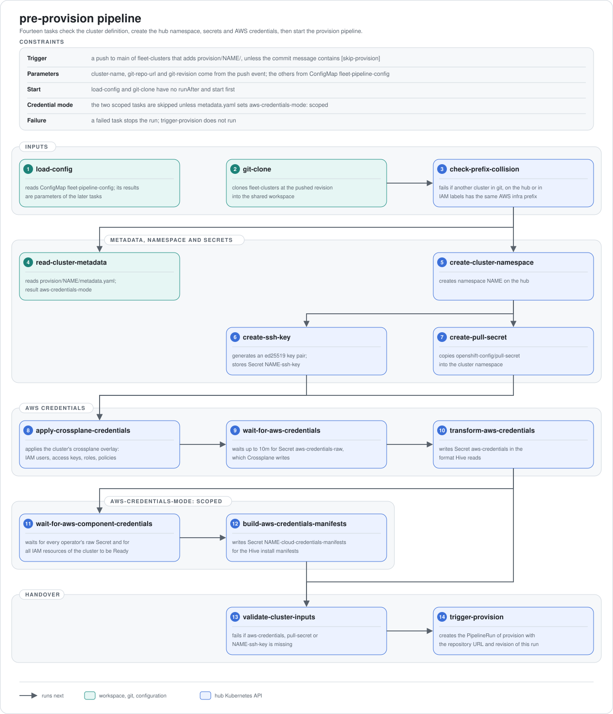
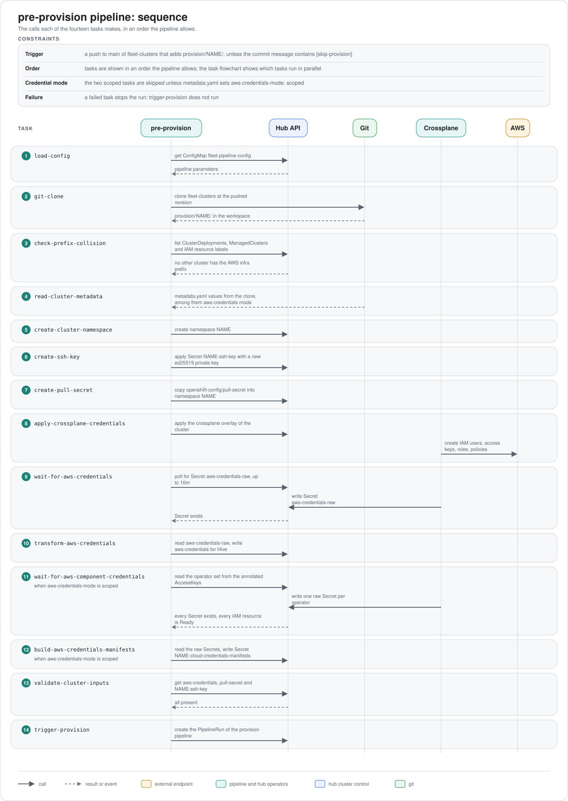
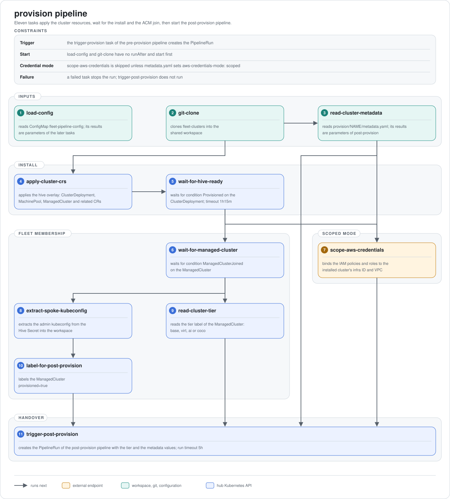
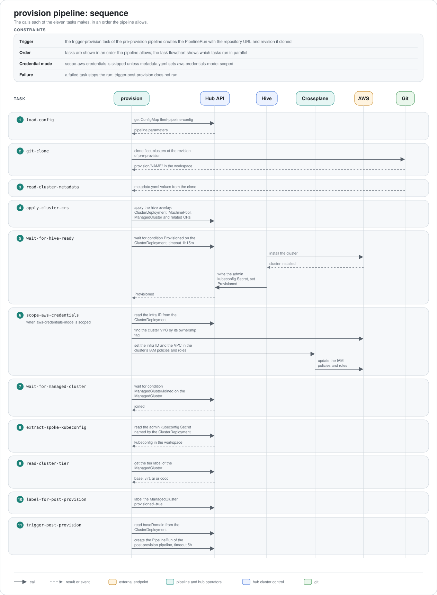
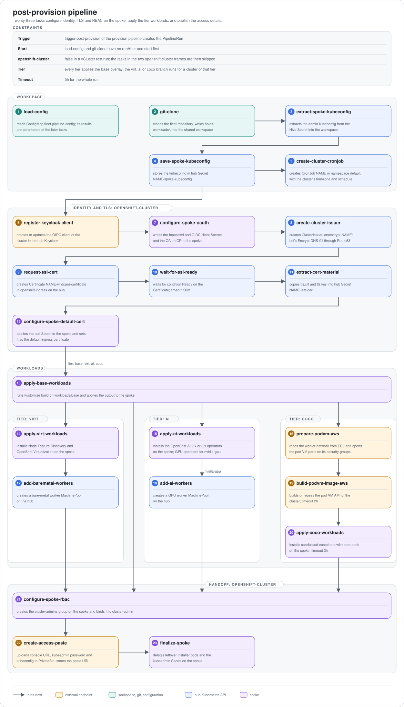
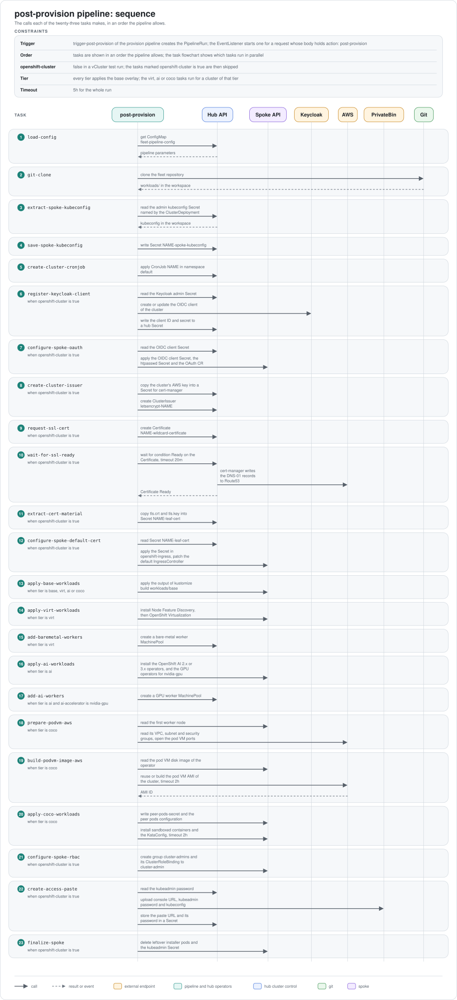
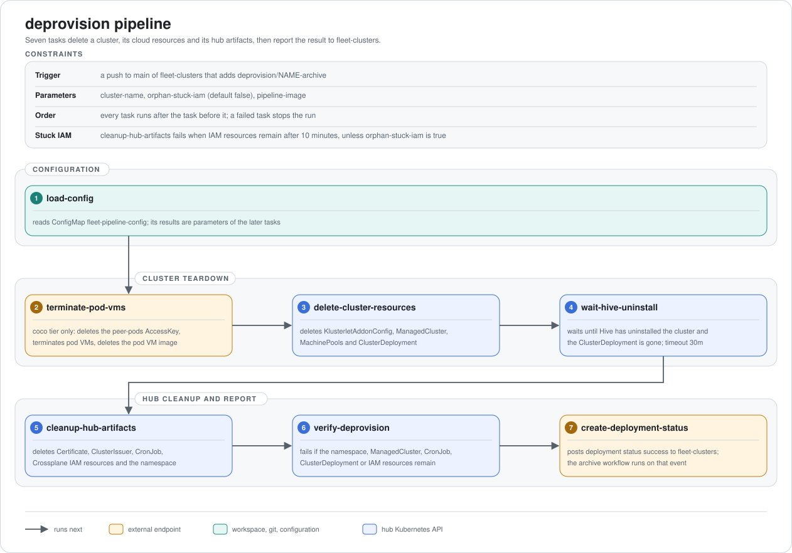
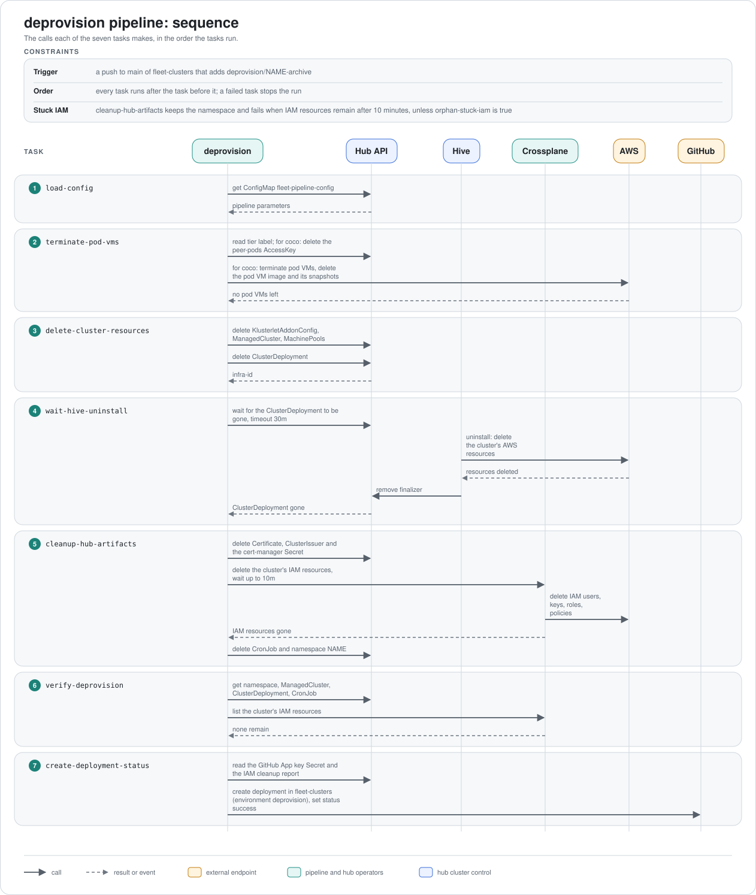

# Architecture

fleet runs the lifecycle of the Red Hat OpenShift Partner Labs clusters from one hub cluster. Git holds the cluster definitions, Tekton pipelines on the hub run the ordered work, and Hive with ACM installs and tracks the clusters. This document describes what the `main` branch implements.

## Components

| Component | Role | Configured in |
|---|---|---|
| fleet-clusters repository | Cluster definitions under `provision/<name>/`, deprovision sentinel files, archive records | [fleet-clusters-setup.md](fleet-clusters-setup.md) |
| fleet repository | Pipelines, tasks, triggers, tier overlays, hub configuration | `tekton/`, `workloads/`, `hub-config/`, `bootstrap/` |
| Tekton (OpenShift Pipelines) | Runs the four lifecycle pipelines and `test-vcluster` | `tekton/`; operator in `hub-config/tekton/` |
| ArgoCD (OpenShift GitOps) | Syncs `hub-config/` to the hub through the Application `fleet-hub-config` | `bootstrap/`, `hub-config/argocd/` |
| Hive and ACM | Hive installs and uninstalls clusters. ACM registers each one as a ManagedCluster, which carries the `tier` label. | `hub-config/acm/` |
| Crossplane | Creates the IAM users, access keys, roles and policies of each cluster | `hub-config/crossplane/` |
| cert-manager | Issues one wildcard certificate per cluster with Let's Encrypt DNS-01 through Route53 | `hub-config/cert-manager/` |
| Keycloak (RH-SSO) | Identity provider; holds one OIDC client per cluster | `hub-config/partner-labs-auth/` |
| Pipeline image | One container image with the `fleet-*` CLI tools and the external tools every task runs | [developer-guide.md](developer-guide.md#container-image) |



Diagram source: [diagrams/architecture.mermaid](diagrams/architecture.mermaid)

## Trust boundary

Third parties have access to a spoke. A pipeline task derives each artifact on the hub and writes only that artifact to the spoke.

| Stays on the hub | Written to the spoke |
|---|---|
| Certificate Secret `<name>-wildcard-certificate` and the ACME account key of ClusterIssuer `letsencrypt-<name>` | `tls.crt` and `tls.key` of the cluster's own certificate |
| Keycloak admin Secret | Client ID and secret of the cluster's own OIDC client |
| Installer AWS key of a `scoped` cluster | One AWS credential per operator, limited to that cluster |
| The admin kubeconfig Secret that Hive writes, and its copy `<name>-spoke-kubeconfig` | Nothing |

Two rules apply to every change:

- No Secret data and no personal data is committed to Git.
- A hub Secret is not copied to a spoke as it is.

A `legacy` cluster is the exception to the third row: its installer key is on the spoke. See [AWS credential modes](#aws-credential-modes).

## Trigger chain

1. A push to `main` of fleet-clusters reaches the EventListener `fleet-cluster-lifecycle` as a GitHub webhook. The listener checks the signature against Secret `fleet-webhook-secret`.
2. A push that adds a file under `provision/<name>/` starts `pre-provision` for `<name>`. A commit message that contains `[skip-provision]` prevents the run.
3. The last task of `pre-provision` creates the PipelineRun of `provision`. The last task of `provision` creates the PipelineRun of `post-provision`.
4. A push that adds `deprovision/<name>-archive` starts `deprovision` for `<name>`. A commit message that contains `[skip-deprovision]` prevents the run.
5. The last task of `deprovision` posts a GitHub deployment status to fleet-clusters. The archive workflow of that repository moves `provision/<name>` to `archive/<name>` and removes the sentinel.

The EventListener also starts `post-provision` for a request whose JSON body holds `action: post-provision` and the parameters of the run, among them `cluster_name`, `tier` and `dns_zones`. Such a request runs `post-provision` without the two pipelines before it.

Every pipeline starts with `load-config`, which reads ConfigMap `fleet-pipeline-config` ([tekton/configmap-defaults.yaml](../tekton/configmap-defaults.yaml)). [parameter-threading.md](parameter-threading.md) describes how a value reaches a task.

## Pipelines

| Pipeline | Tasks | Started by | Last task |
|---|---|---|---|
| [`pre-provision`](../tekton/pipelines/pre-provision.yaml) | 14 | Push that adds `provision/<name>/` | `trigger-provision` |
| [`provision`](../tekton/pipelines/provision.yaml) | 11 | `trigger-provision` | `trigger-post-provision` |
| [`post-provision`](../tekton/pipelines/post-provision.yaml) | 23 | `trigger-post-provision`, or a request with `action: post-provision` | `finalize-spoke` |
| [`deprovision`](../tekton/pipelines/deprovision.yaml) | 7 | Push that adds `deprovision/<name>-archive` | `create-deployment-status` |

A fifth pipeline, `test-vcluster`, runs `post-provision` against a temporary vCluster. See [vcluster.md](vcluster.md).

Each section below has three views of one pipeline:

- Task flowchart: one card per task, one arrow per `runAfter` entry.
- Task table: what each task does, what it talks to, and when it runs. `NAME` stands for the cluster name.
- Sequence diagram: the calls of each task, in an order the pipeline allows.

### pre-provision

Checks the cluster definition, creates the hub namespace, the SSH key, the pull secret and the AWS credentials, then starts `provision`.



Diagram source: [diagrams/pre-provision-flow.mermaid](diagrams/pre-provision-flow.mermaid)

| Task | Talks to | Action | Runs when |
|---|---|---|---|
| `load-config` | Hub API | Reads ConfigMap fleet-pipeline-config; its results are parameters of the later tasks | Always |
| `git-clone` | Git | Clones fleet-clusters at the pushed revision into the shared workspace | Always |
| `check-prefix-collision` | Hub API | Fails if another cluster in git, on the hub or in IAM labels has the same AWS infra prefix | Always |
| `read-cluster-metadata` | Git | Reads provision/NAME/metadata.yaml; result aws-credentials-mode | Always |
| `create-cluster-namespace` | Hub API | Creates namespace NAME on the hub | Always |
| `create-ssh-key` | Hub API | Generates an ed25519 key pair; stores Secret NAME-ssh-key | Always |
| `create-pull-secret` | Hub API | Copies openshift-config/pull-secret into the cluster namespace | Always |
| `apply-crossplane-credentials` | Hub API, Crossplane, AWS | Applies the cluster's crossplane overlay: IAM users, access keys, roles, policies | Always |
| `wait-for-aws-credentials` | Hub API, Crossplane | Waits up to 10m for Secret aws-credentials-raw, which Crossplane writes | Always |
| `transform-aws-credentials` | Hub API | Writes Secret aws-credentials in the format Hive reads | Always |
| `wait-for-aws-component-credentials` | Hub API, Crossplane | Waits for every operator's raw Secret and for all IAM resources of the cluster to be Ready | `aws-credentials-mode` is `scoped` |
| `build-aws-credentials-manifests` | Hub API | Writes Secret NAME-cloud-credentials-manifests for the Hive install manifests | `aws-credentials-mode` is `scoped` |
| `validate-cluster-inputs` | Hub API | Fails if aws-credentials, pull-secret or NAME-ssh-key is missing | Always |
| `trigger-provision` | Hub API | Creates the PipelineRun of the provision pipeline | Always |



Diagram source: [diagrams/pre-provision-sequence.mermaid](diagrams/pre-provision-sequence.mermaid)

### provision

Applies the cluster resources, waits for Hive to install the cluster and for ACM to register it, then starts `post-provision`.



Diagram source: [diagrams/provision-flow.mermaid](diagrams/provision-flow.mermaid)

| Task | Talks to | Action | Runs when |
|---|---|---|---|
| `load-config` | Hub API | Reads ConfigMap fleet-pipeline-config; its results are parameters of the later tasks | Always |
| `git-clone` | Git | Clones fleet-clusters into the shared workspace | Always |
| `read-cluster-metadata` | Git | Reads provision/NAME/metadata.yaml; its results are parameters of post-provision | Always |
| `apply-cluster-crs` | Hub API | Applies the hive overlay: ClusterDeployment, MachinePool, ManagedCluster and related CRs | Always |
| `wait-for-hive-ready` | Hub API, Hive, AWS | Waits for condition Provisioned on the ClusterDeployment; timeout 1h15m | Always |
| `scope-aws-credentials` | Hub API, AWS, Crossplane | Binds the IAM policies and roles to the installed cluster's infra ID and VPC | `aws-credentials-mode` is `scoped` |
| `wait-for-managed-cluster` | Hub API | Waits for condition ManagedClusterJoined on the ManagedCluster | Always |
| `extract-spoke-kubeconfig` | Hub API | Extracts the admin kubeconfig from the Hive Secret into the workspace | Always |
| `read-cluster-tier` | Hub API | Reads the tier label of the ManagedCluster: base, virt, ai or coco | Always |
| `label-for-post-provision` | Hub API | Labels the ManagedCluster provisioned=true | Always |
| `trigger-post-provision` | Hub API | Creates the PipelineRun of the post-provision pipeline with the tier and the metadata values; run timeout 5h | Always |



Diagram source: [diagrams/provision-sequence.mermaid](diagrams/provision-sequence.mermaid)

### post-provision

Configures OAuth, the TLS certificate and RBAC on the spoke, applies the workloads of the cluster's tier, and publishes the access details. The run has a timeout of 5 hours.



Diagram source: [diagrams/post-provision-flow.mermaid](diagrams/post-provision-flow.mermaid)

| Task | Talks to | Action | Runs when |
|---|---|---|---|
| `load-config` | Hub API | Reads ConfigMap fleet-pipeline-config; its results are parameters of the later tasks | Always |
| `git-clone` | Git | Clones the fleet repository, which holds workloads/, into the shared workspace | Always |
| `extract-spoke-kubeconfig` | Hub API | Extracts the admin kubeconfig from the Hive Secret into the workspace | Always |
| `save-spoke-kubeconfig` | Hub API | Stores the kubeconfig in hub Secret NAME-spoke-kubeconfig | Always |
| `create-cluster-cronjob` | Hub API | Creates CronJob NAME in namespace default with the cluster's timezone and schedule | Always |
| `register-keycloak-client` | Hub API, Keycloak | Creates or updates the OIDC client of the cluster in the hub Keycloak | `openshift-cluster` is `true` |
| `configure-spoke-oauth` | Hub API, Spoke API | Writes the htpasswd and OIDC client Secrets and the OAuth CR to the spoke | `openshift-cluster` is `true` |
| `create-cluster-issuer` | Hub API | Creates ClusterIssuer letsencrypt-NAME: Let's Encrypt DNS-01 through Route53 | `openshift-cluster` is `true` |
| `request-ssl-cert` | Hub API | Creates Certificate NAME-wildcard-certificate in openshift-ingress on the hub | `openshift-cluster` is `true` |
| `wait-for-ssl-ready` | Hub API, AWS | Waits for condition Ready on the Certificate; timeout 20m | `openshift-cluster` is `true` |
| `extract-cert-material` | Hub API | Copies tls.crt and tls.key into hub Secret NAME-leaf-cert | `openshift-cluster` is `true` |
| `configure-spoke-default-cert` | Hub API, Spoke API | Applies the leaf Secret to the spoke and sets it as the default ingress certificate | `openshift-cluster` is `true` |
| `apply-base-workloads` | Spoke API | Runs kustomize build on workloads/base and applies the output to the spoke | `tier` is `base`, `virt`, `ai` or `coco` |
| `apply-virt-workloads` | Spoke API | Installs Node Feature Discovery and OpenShift Virtualization on the spoke | `tier` is `virt` |
| `add-baremetal-workers` | Hub API | Creates a bare-metal worker MachinePool on the hub | `tier` is `virt` |
| `apply-ai-workloads` | Spoke API | Installs the OpenShift AI 2.x or 3.x operators on the spoke; GPU operators for nvidia-gpu | `tier` is `ai` |
| `add-ai-workers` | Hub API | Creates a GPU worker MachinePool on the hub | `tier` is `ai` and `ai-accelerator` is `nvidia-gpu` |
| `prepare-podvm-aws` | Spoke API, AWS | Reads the worker network from EC2 and opens the pod VM ports on its security groups | `tier` is `coco` |
| `build-podvm-image-aws` | Spoke API, AWS | Builds or reuses the pod VM AMI of the cluster; timeout 2h | `tier` is `coco` |
| `apply-coco-workloads` | Spoke API | Installs sandboxed containers with peer pods on the spoke; timeout 2h | `tier` is `coco` |
| `configure-spoke-rbac` | Spoke API | Creates the cluster-admins group on the spoke and binds it to cluster-admin | `openshift-cluster` is `true` |
| `create-access-paste` | Hub API, PrivateBin | Uploads console URL, kubeadmin password and kubeconfig to PrivateBin; stores the paste URL | `openshift-cluster` is `true` |
| `finalize-spoke` | Spoke API | Deletes leftover installer pods and the kubeadmin Secret on the spoke | `openshift-cluster` is `true` |

`openshift-cluster` is `false` in a `test-vcluster` run. The tier documents describe the tier tasks: [coco-tier.md](coco-tier.md) and [openshift-ai-operator-and-component-mapping.md](openshift-ai-operator-and-component-mapping.md).



Diagram source: [diagrams/post-provision-sequence.mermaid](diagrams/post-provision-sequence.mermaid)

### deprovision

Deletes a cluster, its AWS resources and its hub artifacts, then reports the result to fleet-clusters. Every task runs after the task before it.



Diagram source: [diagrams/deprovision-flow.mermaid](diagrams/deprovision-flow.mermaid)

| Task | Talks to | Action | Runs when |
|---|---|---|---|
| `load-config` | Hub API | Reads ConfigMap fleet-pipeline-config; its results are parameters of the later tasks | Always |
| `terminate-pod-vms` | Hub API, AWS | Coco tier only: deletes the peer-pods AccessKey, terminates pod VMs, deletes the pod VM image | Always |
| `delete-cluster-resources` | Hub API | Deletes KlusterletAddonConfig, ManagedCluster, MachinePools and ClusterDeployment | Always |
| `wait-hive-uninstall` | Hub API, Hive, AWS | Waits until Hive has uninstalled the cluster and the ClusterDeployment is gone; timeout 30m | Always |
| `cleanup-hub-artifacts` | Hub API, Crossplane, AWS | Deletes Certificate, ClusterIssuer, CronJob, Crossplane IAM resources and the namespace | Always |
| `verify-deprovision` | Hub API, Crossplane | Fails if the namespace, ManagedCluster, CronJob, ClusterDeployment or IAM resources remain | Always |
| `create-deployment-status` | Hub API, GitHub | Posts deployment status success to fleet-clusters; the archive workflow runs on that event | Always |

`terminate-pod-vms` runs for every tier and returns at once unless the `tier` label is `coco` and the cluster is installed.



Diagram source: [diagrams/deprovision-sequence.mermaid](diagrams/deprovision-sequence.mermaid)

## AWS credential modes

`aws-credentials-mode` in the cluster's `metadata.yaml` selects how a spoke gets its AWS credentials. `fleet-cluster-scaffold` writes the key.

| Mode | Spoke credentials | Tasks that run |
|---|---|---|
| `scoped` (default for new clusters) | `credentialsMode: Manual`. One IAM user per OpenShift operator and BYO node roles, each limited to the cluster: instance profile, ownership tag `openshiftpartnerlabs.com/cluster`, bucket prefix, `*.apps.<name>` records. The installer key stays on the hub. | `wait-for-aws-credentials`, `transform-aws-credentials`, `wait-for-aws-component-credentials`, `build-aws-credentials-manifests`, and `scope-aws-credentials` in `provision` |
| `legacy` (key absent; existing clusters) | CCO Mint mode. The account-admin installer key is stored on the spoke in `kube-system/aws-creds`. | `wait-for-aws-credentials`, `transform-aws-credentials` |

A human migrates or destroys existing `legacy` clusters. No pipeline changes their mode.

### Operator discovery

fleet keeps no list of operators. The tasks read the operator set from the cluster's Crossplane AccessKeys on the hub.

`fleet-cluster-scaffold` puts three annotations on every operator AccessKey:

| Annotation | Value |
|---|---|
| `openshiftpartnerlabs.com/credentials-request` | The CredentialsRequest the credential answers |
| `openshiftpartnerlabs.com/target-namespace` | Namespace of the Secret on the spoke |
| `openshiftpartnerlabs.com/target-secret` | Name of the Secret on the spoke |

The AccessKey's `writeConnectionSecretToRef` names the raw credential Secret. The installer AccessKey carries no annotations.

An overlay rendered before the annotations existed fails `pre-provision` with the message `regenerate the overlay with the current fleet-cluster-scaffold`.

### Credentials at install time

1. `wait-for-aws-component-credentials` waits until every operator's raw Secret exists and every Crossplane IAM resource of the cluster reports `Ready`. It finds the installer set and the BYO node roles by name and every other resource by the label `openshiftpartnerlabs.com/cluster=<name>`. The installer tags the node roles, so they must exist before the install.
2. On timeout the task logs the Synced message of each unready resource, for example an AWS `AccessDenied` for the hub's Crossplane identity.
3. `build-aws-credentials-manifests` turns each raw Secret into a Secret manifest for the annotated namespace and name, and bundles the manifests as Secret `<name>-cloud-credentials-manifests`.
4. Hive adds the bundle to the install manifests through `ClusterDeployment.spec.provisioning.manifestsSecretRef`.

### Credentials delivered after the install

An AccessKey can carry the annotation `openshiftpartnerlabs.com/delivery`.

| Value | Effect |
|---|---|
| Absent | The credential goes into the install manifests. |
| `post-provision` | `wait-for-aws-component-credentials` waits for the raw Secret. `build-aws-credentials-manifests` leaves the credential out of the bundle. A `post-provision` task writes the Secret to the spoke, because the target namespace does not exist at install time. |
| Any other value | Discovery fails with the message `update the pipeline image`. |

The peer-pods credential of the `coco` tier is the only credential delivered this way:

- `apply-coco-workloads` writes it to `openshift-sandboxed-containers-operator/peer-pods-secret`.
- `terminate-pod-vms` deletes its AccessKey and terminates the cluster's pod VMs before `delete-cluster-resources` runs.
- `build-podvm-image-aws` builds the pod VM AMI per cluster with the installer credential. `terminate-pod-vms` deletes the AMI and its snapshots.

See [coco-tier.md](coco-tier.md).

### Binding to the installed cluster

Policies rendered by the scaffold contain `INFRA_ID_PLACEHOLDER` and `VPC_ID_PLACEHOLDER`, which match nothing until the cluster is installed. `scope-aws-credentials` runs after `wait-for-hive-ready` and before `trigger-post-provision`. It reads the infra ID from the ClusterDeployment, looks up the cluster VPC with the hub's installer key, and substitutes both values. After that:

- Resources tagged only `kubernetes.io/cluster/<infraID>=owned` count as owned. The cloud-controller-manager, machine-api and EBS CSI always apply that tag, so a partner `LoadBalancer` Service needs no annotation.
- Changes to egress-IP network interfaces are limited to the cluster VPC.

The hub's Crossplane identity needs extra IAM actions for scoped clusters (node roles and policy versions). See "Credentials Setup" in [hub-config/README.md](../hub-config/README.md).

### IAM cleanup at deprovision

`cleanup-hub-artifacts` deletes the cluster's Crossplane IAM resources and waits up to 10 minutes for them to be gone. It finds them by the label `openshiftpartnerlabs.com/cluster=<name>`, and the installer set and node roles also by name.

| Situation | Result |
|---|---|
| The label lookup fails | The task fails before any deletion and keeps the namespace. Run `deprovision` again when the hub API answers. |
| Resources remain at the timeout | The task logs the AWS name and conditions of each one and fails before it deletes the namespace. |
| Resources remain and `orphan-stuck-iam` is `true` | The task saves the unresolved AWS identities to a ConfigMap in the pipeline namespace, then removes the Crossplane finalizers. |

The task does not remove finalizers by default: that would leave live IAM users and access keys in AWS, and some of those keys were on the spoke.

When the provider cannot reach AWS, run:

```bash
tkn pipeline start deprovision -p cluster-name=<name> -p orphan-stuck-iam=true
```

`verify-deprovision` must pass before `create-deployment-status` posts the status. The archive workflow copies the IAM cleanup report into the archived cluster directory. [user-guide.md](user-guide.md#retry-report-delivery) describes how to deliver the report again.

### OCP minor upgrades of scoped clusters

1. Compare the AWS CredentialsRequests of the release with `aws_policies.py` of `fleet-cluster-scaffold`.
2. Apply the crossplane overlay again.
3. Set `cloudcredential.openshift.io/upgradeable-to` on the spoke.

## Not implemented

| Item | Current behaviour |
|---|---|
| Spoke certificate rotation | cert-manager renews the certificate on the hub. No pipeline writes the renewed leaf certificate to the spoke. |
| Deprovision approval gate | `deprovision` starts on the push. No task waits for a manual approval. |

## Related documentation

| Document | Covers |
|---|---|
| [user-guide.md](user-guide.md) | Provisioning, deprovisioning and troubleshooting a cluster |
| [developer-guide.md](developer-guide.md) | Local setup, checks, adding a task, updating a diagram |
| [fleet-clusters-setup.md](fleet-clusters-setup.md) | Repository structure, GitHub App, webhook, archive workflow |
| [per-cluster-metadata.md](per-cluster-metadata.md) | The `metadata.yaml` keys |
| [parameter-threading.md](parameter-threading.md) | How a parameter passes from a trigger to a task |
| [hub-config/README.md](../hub-config/README.md) | Installing and verifying the hub operators |
