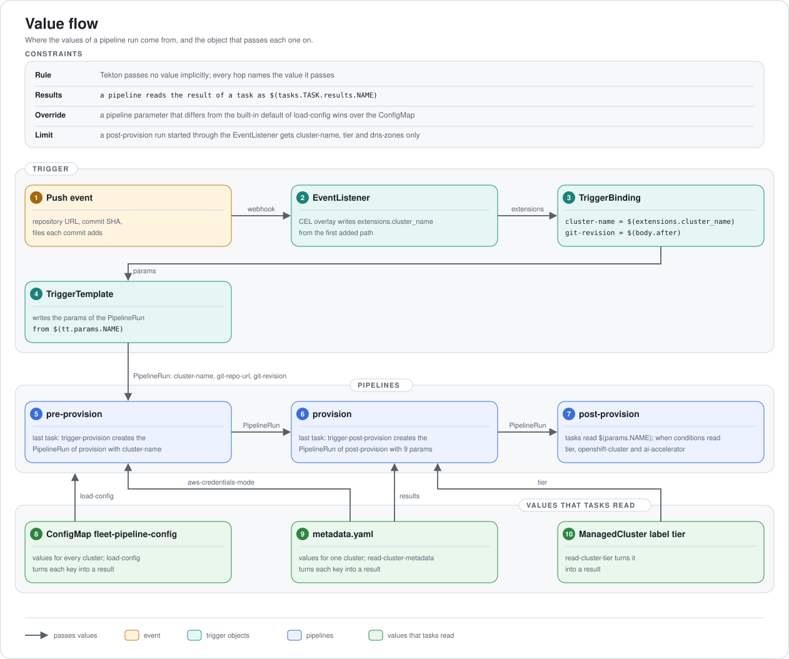

# Parameter Threading

This document describes where the values of a pipeline run come from and how each one reaches the task that uses it.

Tekton passes no value implicitly. Every object on the way declares the value and names the object it reads it from. [per-cluster-metadata.md](per-cluster-metadata.md) lists the keys of `metadata.yaml`, and [hub-setup.md](hub-setup.md#6-set-the-pipeline-configuration) lists the keys of the ConfigMap.

## Sources

| Source | Holds | Enters a run through |
|---|---|---|
| Push event of fleet-clusters | The SSH URL of the repository, the commit SHA, the files each commit adds | The EventListener, the TriggerBinding and the TriggerTemplate, as parameters of the `pre-provision` PipelineRun |
| ConfigMap `fleet-pipeline-config` | Values that are the same for every cluster | `load-config`, the first task of every pipeline |
| `metadata.yaml` of the cluster | Values of one cluster | `read-cluster-metadata`, in `pre-provision` and in `provision` |
| Resources on the hub | The `tier` label of the ManagedCluster, the infra ID of the ClusterDeployment | The task that reads the resource, as a task result |
| Pipeline definition | The default of a pipeline parameter | The `params` of the pipeline |



Diagram source: [diagrams/value-flow.mermaid](diagrams/value-flow.mermaid)

## Syntax of each hop

| Hop | Object | Syntax | Example |
|---|---|---|---|
| Event to extension | EventListener, CEL overlay | A CEL expression on `body` | `body.commits.map(...)` |
| Event to parameter | TriggerBinding | `$(body.NAME)`, `$(extensions.NAME)` | `$(extensions.cluster_name)` |
| Parameter to PipelineRun | TriggerTemplate | `$(tt.params.NAME)` | `$(tt.params.cluster-name)` |
| Pipeline to task | Pipeline | `$(params.NAME)` | `$(params.cluster-name)` |
| Task to script | Task | `$(params.NAME)` | `--cluster-name "$(params.cluster-name)"` |
| Script to pipeline | Task result | The script writes the file `$(results.NAME.path)` | `$(results.tier.path)` |
| Task to later task | Pipeline | `$(tasks.TASK.results.NAME)` | `$(tasks.read-cluster-tier.results.tier)` |
| Pipeline to pipeline | `trigger-provision`, `trigger-post-provision` | The CLI writes a PipelineRun and creates it with `oc create` | `generateName: provision-{cluster}-` |

## Trace of cluster-name

The cluster name passes through ten hops from the push to a task of `post-provision`. A test compares each expression with the file.

| Hop | File | Expression | Effect |
|---|---|---|---|
| 1 | `tekton/triggers/eventlistener.yaml` | `body.commits.map(c, c.added.filter(f, f.startsWith('provision/')))` | The CEL overlay takes the second path segment of the first added file and writes `extensions.cluster_name` |
| 2 | `tekton/triggers/triggerbinding-pre-provision.yaml` | `value: $(extensions.cluster_name)` | The binding names the value `cluster-name` |
| 3 | `tekton/triggers/triggertemplate-pre-provision.yaml` | `value: $(tt.params.cluster-name)` | The template writes it into the PipelineRun of `pre-provision` |
| 4 | `tekton/pipelines/pre-provision.yaml` | `value: $(params.cluster-name)` | The pipeline passes it to each task that declares it |
| 5 | `tekton/tasks/trigger-provision.yaml` | `--cluster-name "$(params.cluster-name)"` | The last task passes it to its CLI |
| 6 | `fleet/tasks/trigger_provision.py` | `generateName: provision-{cluster}-` | The CLI writes the PipelineRun of `provision` with the parameter `cluster-name` and creates it |
| 7 | `tekton/pipelines/provision.yaml` | `value: $(params.cluster-name)` | The pipeline passes it to each task that declares it |
| 8 | `tekton/tasks/trigger-post-provision.yaml` | `--cluster-name "$(params.cluster-name)"` | The last task passes it to its CLI |
| 9 | `fleet/tasks/trigger_post_provision.py` | `generateName: post-provision-{cluster}-` | The CLI writes the PipelineRun of `post-provision` with nine parameters and creates it |
| 10 | `tekton/pipelines/post-provision.yaml` | `value: $(params.cluster-name)` | The pipeline passes it to each task that declares it |

The nine parameters of hop 9 are `cluster-name`, `tier`, `dns-zones`, and the six metadata values `htpasswd-provider-name`, `openshift-ai-version`, `ai-accelerator`, `timezone`, `schedule` and `podvm-instance-type`. The CLI derives `dns-zones` from the `baseDomain` of the ClusterDeployment.

## load-config

Every pipeline starts with `load-config`, which runs the Task `config-loader`. The pipeline passes its own parameters to the task, and the task writes one result per key. For each key it applies this rule:

| The pipeline parameter is | The result is |
|---|---|
| Empty, or equal to the built-in default of `config-loader` | The value of the ConfigMap |
| Any other value | The pipeline parameter |

Later tasks read `$(tasks.load-config.results.NAME)`.

Two consequences:

- `git-repo-url` has the built-in default of the fleet repository. `pre-provision` and `provision` set the parameter to fleet-clusters, so they clone fleet-clusters. `post-provision` keeps the default, so it clones the repository that the ConfigMap names.
- A parameter that equals the built-in default cannot override the ConfigMap.

The built-in default of a key is written twice in [tekton/tasks/config-loader.yaml](../tekton/tasks/config-loader.yaml): as the default of the task parameter and in the line that resolves the key.

## Task results

| Step | How | Example |
|---|---|---|
| A task writes a result | The script writes the value to `$(results.NAME.path)` | `read-cluster-tier` pipes the output of its CLI to the file |
| A pipeline reads it | `$(tasks.TASK.results.NAME)` in a parameter of a later task | `tier` of `trigger-post-provision` |
| A condition reads it | The same expression as the `input` of a `when` | `aws-credentials-mode` gates `scope-aws-credentials` |
| The next pipeline gets it | The task that creates the next PipelineRun receives it as a parameter | The six metadata values in `provision` |

A task that reads a result runs after the task that writes it, without a `runAfter` entry.

Tekton keeps a result file as it is, and a `when` condition compares the whole value. `read-cluster-metadata` therefore writes each result without a trailing newline, through the function `result` of its script. `tests/validation/test_read_cluster_metadata_task.py` fails when a result gains one.

## Add a per-cluster value

A new key of `metadata.yaml` passes through the same objects as the existing keys. The default of the key is written in each of them; keep the values equal.

1. `fleet/tasks/read_cluster_metadata.py`: validate the value, if only some values are valid. Add the cases to `tests/unit/test_read_cluster_metadata.py`.
2. `tekton/tasks/read-cluster-metadata.yaml`: add the result, and one `result` line with the default.
3. `tests/validation/test_read_cluster_metadata_task.py`: add the key to the expected results.
4. `tekton/pipelines/provision.yaml`: pass the result to `trigger-post-provision`.
5. `tekton/tasks/trigger-post-provision.yaml`: add the parameter and the argument of the CLI.
6. `fleet/tasks/trigger_post_provision.py`: add the argument and the parameter of the PipelineRun. Add the case to `tests/unit/test_trigger_post_provision.py`.
7. `tekton/pipelines/post-provision.yaml`: add the pipeline parameter and pass it to the task that uses it, or read it in a `when` condition.
8. The task that uses the value: add the parameter to its Task and the argument to its CLI.
9. `docs/per-cluster-metadata.md`: add the row of the key. A test compares the table with the Task.

A value that `pre-provision` needs is read there directly from the result of `read-cluster-metadata`, as `aws-credentials-mode` is.

The CLI of step 1 prints the file as JSON:

```bash
fleet-read-cluster-metadata --cluster-dir <workspace>/provision/<name>
```

It prints `{}` for a missing or empty file. It exits with 1 when the directory does not exist, when the file is not a map, and for an invalid value.

## Limits

- A `post-provision` run that the EventListener starts gets `cluster_name`, `tier` and `dns_zones` from the request body. It receives no metadata value and runs with the defaults of the pipeline parameters.
- `pre-provision` clones fleet-clusters at the pushed commit. `provision` receives only `cluster-name`, so it clones the branch `main`.
