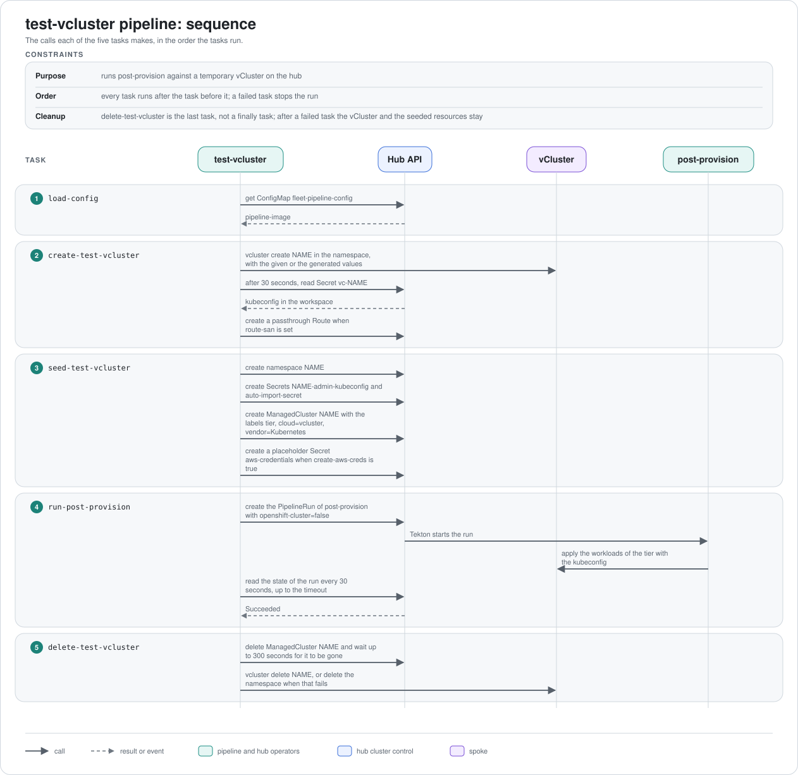

# vCluster Test

This document describes how the `test-vcluster` pipeline tests `post-provision` against a temporary vCluster on the hub, and what the test covers.

A vCluster is a Kubernetes cluster that runs as pods in one namespace of the hub. The test needs no cloud resources. `<name>` is the cluster name of the test.

## What the test covers

`run-post-provision` starts `post-provision` with `openshift-cluster=false`. Ten tasks need an OpenShift cluster and are skipped:

| Task | Not tested |
|---|---|
| `register-keycloak-client` | The OIDC client in Keycloak |
| `configure-spoke-oauth` | OAuth on the spoke |
| `create-cluster-issuer` | The ClusterIssuer of the cluster |
| `request-ssl-cert` | The Certificate |
| `wait-for-ssl-ready` | The wait for the Certificate |
| `extract-cert-material` | The leaf Secret |
| `configure-spoke-default-cert` | The default ingress certificate |
| `configure-spoke-rbac` | The group `cluster-admins` |
| `create-access-paste` | The access paste |
| `finalize-spoke` | The removal of installer pods and of the kubeadmin Secret |

The other tasks run as for a real cluster; [architecture.md](architecture.md#post-provision) lists them.

- `load-config`, `git-clone`, `extract-spoke-kubeconfig`, `save-spoke-kubeconfig`, `create-cluster-cronjob` and `apply-base-workloads` run for every tier.
- The tasks of the tier run for `virt`, `ai` and `coco`.
- The run receives no value of `metadata.yaml`. It uses the defaults of the pipeline parameters.

## Run the test

The pipeline has nine parameters and the workspace `shared-workspace`.

| Parameter | Default | Effect |
|---|---|---|
| `cluster-name` | Required | Name of the vCluster, of the namespace for the hub resources, and of the ManagedCluster |
| `namespace` | Required | Namespace of the hub in which the vCluster runs |
| `tier` | `base` | Tier label of the ManagedCluster and tier of the `post-provision` run |
| `pipeline-image` | `quay.io/rhopl/fleet-pipeline:latest` | Image of the task steps |
| `values-file` | Empty | Path of a vCluster values file in the workspace. It replaces the generated values. |
| `extra-sans` | Empty | Names to add to the certificate of the vCluster API, separated by spaces |
| `route-san` | Empty | Host name of a passthrough Route to the vCluster API. The kubeconfig then uses `https://<route-san>:443`. |
| `create-aws-creds` | `false` | `true` creates a placeholder Secret `aws-credentials` |
| `timeout` | `600` | Seconds to wait for the `post-provision` run |

> **To be verified:** the command that starts the pipeline. This section will hold it once it is confirmed on a hub.

No task writes to the workspace before `create-test-vcluster`, so a `values-file` must already be on the volume that the run gets.

## The pipeline


Diagram source: [diagrams/test-vcluster-flow.mermaid](diagrams/test-vcluster-flow.mermaid)

| Task | Tool | Action |
|---|---|---|
| `load-config` | Task `config-loader` | Reads the ConfigMap `fleet-pipeline-config`. The later tasks use its result `pipeline-image`. |
| `create-test-vcluster` | `fleet-create-test-vcluster` | Runs `vcluster create <name> -n <namespace> --connect=false`, waits 30 seconds, reads the kubeconfig from the Secret `vc-<name>`, and writes it to the file `kubeconfig` of the workspace |
| `seed-test-vcluster` | `fleet-seed-test-vcluster` | Creates the hub resources that `post-provision` expects of a cluster; see [Hub resources](#hub-resources) |
| `run-post-provision` | `fleet-run-post-provision` | Creates the PipelineRun of `post-provision` and reads its state every 30 seconds until it succeeds, fails, or the timeout passes |
| `delete-test-vcluster` | `fleet-delete-test-vcluster` | Deletes the ManagedCluster, waits up to 300 seconds for it to be gone, then runs `vcluster delete`. When that fails, it deletes the namespace of the vCluster. |



Diagram source: [diagrams/test-vcluster-sequence.mermaid](diagrams/test-vcluster-sequence.mermaid)

Every task runs after the task before it. `delete-test-vcluster` is the last task and not a `finally` task: when an earlier task fails, it does not run.

## Hub resources

| Resource | Namespace | Created by | Deleted by |
|---|---|---|---|
| The vCluster `<name>` with its Secret `vc-<name>` | The parameter `namespace` | `create-test-vcluster` | `delete-test-vcluster` |
| Route `<name>`, only with `route-san` | The parameter `namespace` | `create-test-vcluster` | No task |
| Namespace `<name>` | | `seed-test-vcluster` | No task |
| Secret `<name>-admin-kubeconfig` | `<name>` | `seed-test-vcluster` | No task |
| Secret `auto-import-secret` | `<name>` | `seed-test-vcluster` | No task |
| Secret `aws-credentials`, only with `create-aws-creds` | `<name>` | `seed-test-vcluster` | No task |
| ManagedCluster `<name>` with the labels `tier`, `cloud=vcluster` and `vendor=Kubernetes` | | `seed-test-vcluster` | `delete-test-vcluster` |
| PipelineRun `post-provision-<name>-*` | `openshift-pipelines` | `run-post-provision` | No task |
| CronJob `<name>` | `default` | `create-cluster-cronjob` of `post-provision` | No task |
| Secret `<name>-spoke-kubeconfig` | `openshift-pipelines` | `save-spoke-kubeconfig` of `post-provision` | No task |

`post-provision` finds the kubeconfig through its parameter `spoke-kubeconfig`, which `run-post-provision` sets to `<name>-admin-kubeconfig`. For a real cluster the parameter is empty and the task reads the Secret that the ClusterDeployment names.

Without `values-file`, `create-test-vcluster` generates the values of the vCluster: the SANs of the API certificate, and two RoleBindings in the namespace that bind the ServiceAccounts `vc-<name>` and `vc-workload-<name>` to the ClusterRole `cluster-admin`.

## After a failed run

A failed task leaves the vCluster and every resource of the table. A successful run leaves the rows marked "No task". Remove what remains:

```bash
oc delete managedcluster <name> --ignore-not-found
vcluster delete <name> -n <namespace>
oc delete namespace <name> --ignore-not-found
oc delete cronjob <name> -n default --ignore-not-found
oc delete secret <name>-spoke-kubeconfig -n openshift-pipelines --ignore-not-found
```

## CLI reference

### fleet-create-test-vcluster

| Argument | Required | Effect |
|---|---|---|
| `--cluster-name` | Yes | Name of the vCluster |
| `--namespace` | Yes | Namespace of the hub in which the vCluster runs |
| `--output-dir` | Yes | Directory that receives the file `kubeconfig` and the generated values file `vcluster-values.yaml` |
| `--values-file` | No | Values file to use in place of the generated values |
| `--extra-sans` | No | Names to add to the certificate of the vCluster API |
| `--route-san` | No | Host name of the passthrough Route. It is also added to the certificate and set as the server of the kubeconfig. |

The tool exits with 1 when `vcluster create` fails, when the Secret `vc-<name>` cannot be read, and when the Route cannot be created.

### fleet-seed-test-vcluster

| Argument | Required | Effect |
|---|---|---|
| `--cluster-name` | Yes | Name of the namespace for the hub resources and of the ManagedCluster |
| `--kubeconfig-file` | Yes | Path of the kubeconfig that `fleet-create-test-vcluster` wrote |
| `--tier` | Yes | Value of the label `tier` of the ManagedCluster |
| `--create-aws-creds` | No | Creates the placeholder Secret `aws-credentials` |

The Task and the pipeline give `tier` the default `base`. The tool does not check the value.

### fleet-run-post-provision

| Argument | Required | Effect |
|---|---|---|
| `--cluster-name` | Yes | Cluster name of the `post-provision` run |
| `--tier` | Yes | Tier of the `post-provision` run |
| `--namespace` | Yes | Written to the log only |
| `--pipeline-image` | No | Image of the task steps of the run; default `quay.io/rhopl/fleet-pipeline:latest` |
| `--timeout` | No | Seconds to wait for the run; default 600 |

The run gets `openshift-cluster=false`, `spoke-kubeconfig=<name>-admin-kubeconfig`, and placeholders for the Keycloak parameters and `dns-zones`. The tool exits with 1 when the run fails and when the timeout passes.

### fleet-delete-test-vcluster

| Argument | Required | Effect |
|---|---|---|
| `--cluster-name` | Yes | Name of the ManagedCluster and of the vCluster |
| `--namespace` | Yes | Namespace of the vCluster |

The tool skips `vcluster delete` when the namespace no longer exists. It exits with 1 only when `vcluster delete` fails and the namespace cannot be deleted either.

## Differences from a real cluster

| Aspect | Real cluster | vCluster test |
|---|---|---|
| Cluster | Installed by Hive on AWS | Created by `vcluster create` in a namespace of the hub |
| Kubeconfig | The Secret that the ClusterDeployment names | The Secret `<name>-admin-kubeconfig`, named by the parameter `spoke-kubeconfig` |
| ManagedCluster | Applied from the cluster directory and joined by ACM | A stub with `cloud=vcluster` and `vendor=Kubernetes` |
| OAuth, TLS certificate, RBAC, access paste | Configured | Skipped |
| Values of `metadata.yaml` | Passed by `trigger-post-provision` | Not passed; the defaults apply |
| Keycloak parameters and `dns-zones` | From the ConfigMap and the ClusterDeployment | Placeholders |
